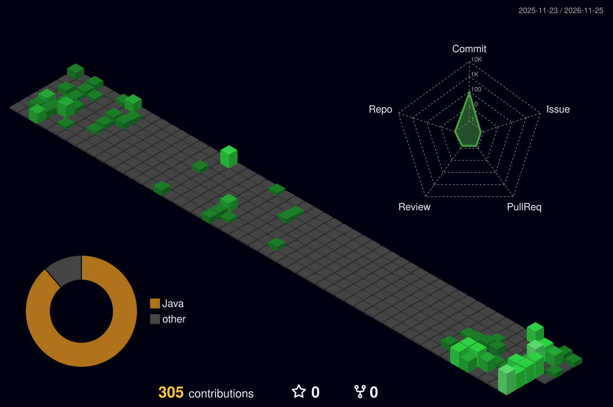

# 👋 Hi, I'm Afonso Mota

  <strong>🎓 Final-year Computer Engineering student at ISEP 🇵🇹</strong>
   
  💡 Interested in software development, backend engineering and building useful projects.

  
  
  

---

## 👨‍💻 About Me

  I'm a final-year Computer Engineering student at <strong>ISEP</strong>, Portugal 🇵🇹.
   
  Passionate about technology, software development and turning ideas into real-world applications.

<table>
  <tr>
    <td width="50%" valign="top">
      <h3>💻 What I Do</h3>
      <ul>
        <li>Build web, mobile and desktop applications.</li>
        <li>Explore backend development and software architecture.</li>
        <li>Experiment with different technologies and development approaches.</li>
      </ul>
    </td>
    <td width="50%" valign="top">
      <h3>🎯 What Interests Me</h3>
      <ul>
        <li>Backend & Full-Stack Development</li>
        <li>Software Architecture & Clean Code</li>
        <li>Problem Solving & Learning New Technologies</li>
        <li>Cybersecurity</li>
      </ul>
    </td>
  </tr>
</table>

---

## 🚀 Featured Projects

<table>
  <tr>
    <td width="50%" valign="top">
      <h3>🍕 <a href="https://github.com/Departamento-de-Engenharia-Informatica/LEI-SEM5-PI-2026-27-3DJ-05">LaPrizza - Enterprise restaurant back-end</a></h3>
      

        <em>Restaurant & Kitchen Management System</em> 
        Academic team project focused on developing an integrated platform for restaurant operations.
      

      <ul>
        <li>Backend services and REST API development.</li>
        <li>Product catalogue and pizza configuration.</li>
        <li>Inventory and kitchen management features.</li>
        <li>Database integration and automated testing.</li>
      </ul>
    </td>
    <td width="50%" valign="top">
      <h3>📱 21Days: Build Habits</h3>
      

        <em>Habit Tracking iOS App</em> 
        A personal project designed to help users build and maintain daily habits.
      

      <ul>
        <li>Daily habit tracking and streaks.</li>
        <li>Progression logic around the first 21 days.</li>
        <li>Notifications and motivational messages.</li>
        <li>Designed, developed and published on the App Store.</li>
      </ul>
    </td>
  </tr>
  <tr>
    <td width="50%" valign="top">
      <h3>🐾 PetsFound - Lost & Found Pets Platform</h3>
      
A platform designed to help reunite lost pets with their owners.

      <ul>
        <li>Interactive maps and geographical search.</li>
        <li>Matching system for lost and found animals.</li>
        <li>Private chat and email verification.</li>
        <li>Payment integration and PDF generation.</li>
      </ul>
    </td>
    <td width="50%" valign="top">
      <h3>📈 iTrading</h3>
      
Landing page developed for a client, focused on presenting a trading-related service.

    </td>
  </tr>
  <tr>
    <td width="50%" valign="top">
      <h3>🚆 <a href="https://github.com/Departamento-de-Engenharia-Informatica/sem3-pi-25-26-g094-repo">Logistics On Rails</a></h3>
      
Java, C/RISC-V and PL/SQL railway platform. 2D-Tree over 64k+ stations, graph algorithms and IoT safety modules.

    </td>
    <td width="50%" valign="top">
      <h3>🧑‍💻 <a href="https://github.com/1241244-PedroRibeiro/1stsemester_project">Facial Reconstruction</a></h3>
      
Eigenfaces in Java, eigendecomposition, covariance optimization and MAE-tracked reconstruction.

    </td>
  </tr>
</table>

---

## 🛠️ Tech Stack

### 💬 Languages

  
  
  
  
  
  
  
  
  
  
  
  

### 🎨 Frontend & Mobile Development

  
  
  
  
  
  
  

### ⚙️ Backend & Frameworks

  
  
  
  
  
  
  

### 🗄️ Databases

  
  
  
  
  

### 🧪 Testing & CI/CD

  
  
  
  
  

### 🔧 Tools & Platforms

  
  
  
  
  
  
  
  

---

## 🧠 Core Concepts & Methodologies

  
  
  
  
  
  
  
  

---

## 🟩 Contribution Activity

  

---

  <em>✨ Always learning, building and exploring new possibilities through technology. 🚀</em>

  

